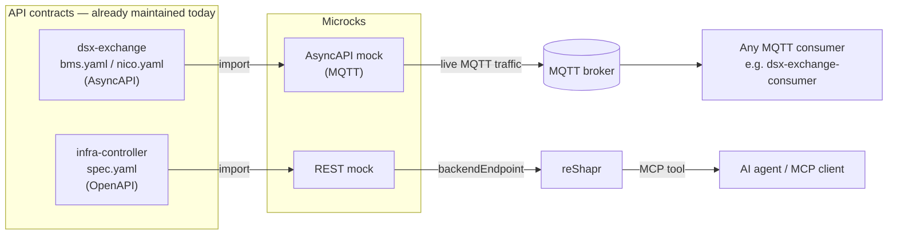

# Microcks + reShapr for NVIDIA DSX

Small, fully reproducible proofs-of-concept showing where
[Microcks](https://microcks.io) (API mocking & contract testing) and
[reShapr](https://reshapr.io) (OpenAPI/GraphQL/gRPC → MCP tool gateway) can
plug directly into NVIDIA's [DSX](https://github.com/dsx-ai-factory)
AI-factory stack — specifically the
[`dsx-exchange`](https://github.com/dsx-ai-factory/dsx-exchange) event bus and
the [`infra-controller`](https://github.com/dsx-ai-factory/infra-controller)
(NICo) bare-metal lifecycle API.

> **Disclosure:** I'm one of the maintainers of both Microcks and reShapr.
> This repo documents my own hands-on technical evaluation of both against
> NVIDIA's public repos — not an official statement from NVIDIA, Microcks,
> or reShapr, and not an independent third-party assessment.

## Try it in 2 minutes

Needs Docker and Python 3, plus local checkouts of `dsx-exchange` and
`infra-controller` next to this repo (the scripts only read them, never modify them).

```sh
docker compose -f microcks/docker-compose.yml up -d    # 3 containers, no login
poc3a/run.sh    # AsyncAPI: replay dsx-exchange#117, expect 6 x [PASS]
poc3a/run_real.sh # AsyncAPI: NICo-serialised messages vs today's nico.yaml (45/49 conform)
poc3b/run.sh    # OpenAPI:  replay infra-controller#5459 (one drift), expect 5 x [PASS]
poc3b/stage2.sh # OpenAPI:  same runner vs a real rest-api (needs Go + Docker; a few minutes)
```

Each script exits non-zero if an expected outcome does not hold, so it can run
in CI (see [`.github/workflows/poc-conformance.yml`](.github/workflows/poc-conformance.yml)).

## In plain terms

NVIDIA's data-center software talks to physical hardware (power systems,
cooling, servers) and exposes its own controls to other software. Today,
testing that talk before the real hardware exists relies on someone having
hand-written a stand-in for it, and letting an AI assistant use those
controls would mean hand-writing a translation layer for it too.

These two demos show that neither has to be hand-written:

- **PoC 1** — Microcks reads the official description of what the hardware
  is supposed to say, and fakes those signals automatically. No custom
  script, and the fake signals are guaranteed to match the real spec.
- **PoC 2** — reShapr reads the official description of an API and builds
  the translation layer an AI assistant needs to call it, automatically. We
  proved it by having an AI-style tool call it directly and get the right
  answer back.

The rest of this document is the technical version, for anyone who wants to
run it themselves.

## The use case

Both `dsx-exchange` and `infra-controller` already describe their APIs with
formal contracts — AsyncAPI for `dsx-exchange`'s MQTT event bus, OpenAPI for
`infra-controller`'s REST surface. Today those contracts are mostly
documentation:

- `dsx-exchange` tests against a hand-built, CSV-driven MQTT simulator
  (`dummy-bms`) instead of its own AsyncAPI specs.
- `infra-controller`'s REST API has no path to being called by an AI agent
  without someone hand-writing an MCP bridge.

Microcks and reShapr both treat an API contract as the single source of
truth — Microcks turns it into a live mock, reShapr turns it into an MCP
tool. Chained together, the same contract a team already maintains gets
you a safe mock **and** an agent-callable tool, with no new code.

Microcks can also run that same contract as a continuous conformance test
against a *real* backend, catching drift automatically instead of via
periodic manual audits. [PoC 3a](docs/poc3a-nico-drift-conformance.md)
demonstrates this for the MQTT side by replaying a real past drift
(dsx-exchange#117). [PoC 3b](docs/poc3b-infra-controller-rest-conformance.md)
does the same for REST on one real drift (infra-controller#5459), against a
stub backend; a real `rest-api` is not demonstrated yet.

## Architecture



Two independent PoCs exercise the two halves of this diagram:

| | Flow | Doc |
|---|---|---|
| **PoC 1** | `bms.yaml`/`nico.yaml` → Microcks → live MQTT traffic | [`docs/poc1-dsx-exchange-mqtt.md`](docs/poc1-dsx-exchange-mqtt.md) |
| **PoC 2** | `spec.yaml` → Microcks → reShapr → MCP tool call | [`docs/poc2-infra-controller-mcp.md`](docs/poc2-infra-controller-mcp.md) |
| **PoC 3b** | `spec.yaml` (before/after #5459 fix) → Microcks OpenAPI test runner → stub backend (stage 1) or a real local `rest-api` (stage 2) → pass/fail | [`docs/poc3b-infra-controller-rest-conformance.md`](docs/poc3b-infra-controller-rest-conformance.md) |
| **PoC 3a** | `nico.yaml` (before/after #117) → Microcks test runner → live MQTT traffic → pass/fail | [`docs/poc3a-nico-drift-conformance.md`](docs/poc3a-nico-drift-conformance.md) |

## Results at a glance

| | |
|---|---|
| **4 / 4** | PoCs verified end-to-end locally on pinned releases (Microcks 1.15.0, reShapr 1.1.0); PoC 3b stage 1 uses a stub backend, stage 2 a real local `rest-api` |
| **45 / 49** | NICo-serialised messages (real `ManagedHostState` serde output, not schema-derived) that conform to today's `nico.yaml`; the 4 that don't are states missing from the spec |
| **12 / 26** | NICo messages rejected by the pre-#117 `nico.yaml` in PoC 3a (0 rejected after #117) |
| **1 / 1** | real `infra-controller` spec drift (#5459, `tpm` array vs object) caught by the OpenAPI test runner in PoC 3b (passes after the fix) |
| **37 / 37** | `rest-api` collection endpoints (empty database) that pass Microcks' OpenAPI test against the real server in PoC 3b stage 2; a deliberately drifted spec fails on exactly 1 |
| **263** | MCP tools generated from `infra-controller`'s real OpenAPI spec (164 paths, 263 operations) in PoC 2 |
| **3** | spec gaps found in `dsx-exchange`, each closable with a few lines |
| **0** | results without a captured command output or evidence file in this repo (scope and limits are listed per PoC) |

Full write-up with every command and output: see
[`docs/poc1-dsx-exchange-mqtt.md`](docs/poc1-dsx-exchange-mqtt.md) and
[`docs/poc2-infra-controller-mcp.md`](docs/poc2-infra-controller-mcp.md).

## What's not yet demonstrated here

- **Contract/conformance testing against a live backend** — PoC 3a runs
  Microcks' test runner against a local Mosquitto broker fed with
  schema-derived messages (plus 49 messages serialised by NICo's own types, replayed
  the same way), and PoC 3b against a stub HTTP backend replaying
  one drift. Neither uses a real NICo, a real DSX broker or a real
  `rest-api` with data: PoC 3b stage 2 runs against a real `rest-api` but with
  an empty database, no Core and no registered site. The upstream
  proposals were
  [dsx-ai-factory/dsx-exchange#118](https://github.com/dsx-ai-factory/dsx-exchange/issues/118)
  (closed as not planned, then reopened by the maintainer on 2026-10-19; open,
  no comments) and
  [dsx-ai-factory/infra-controller#7253](https://github.com/dsx-ai-factory/infra-controller/issues/7253)
  (open, no response yet).
- Microcks' Kubernetes Operator / CRDs — ships in a separate
  `microcks-operator` repo, not inspected here. Worth a look if there's
  interest in a GitOps-native deployment story, since `microcks-operator`
  and `reshapr-controllers` both ship this same CRD/operator pattern
  already.
- Any claim about Omniverse, NIM, NeMo, Base Command, or Spectrum-X.
- CI — a GitHub Actions workflow is included but has not run on GitHub yet
  (this repo has no remote); every result here comes from local runs. The PoC 3b
  step relies on reaching a host stub from Docker on Linux, which is untested.

## Repo layout

```
README.md                              — this file
LICENSE                                — Apache License 2.0
.gitignore
docs/
  poc1-dsx-exchange-mqtt.md            — PoC 1: full reproduction steps
  poc2-infra-controller-mcp.md         — PoC 2: full reproduction steps
  poc3a-nico-drift-conformance.md      — PoC 3a: replay of dsx-exchange#117 as a test
  poc3b-infra-controller-rest-conformance.md — PoC 3b: replay of infra-controller#5459 as a test
  notes-core-mock-comparison.md        — manual spike: Microcks vs mock-core (not scripted)
poc3a/
  run.sh, run_poc3a.py, gen_payloads.py — one-command reproduction (schema-derived traffic)
  run_real.sh, run_real.py, real/        — replay of NICo-serialised messages; real/ regenerates the fixture
  evidence/                            — captured run log and per-message results
poc3b/
  run.sh, run_poc3b.py                 — stage 1: one-command reproduction (stub backend)
  stage2.sh, run_stage2.py, make_token.py, stage2-config.yaml — stage 2: real local rest-api
  evidence/                            — captured run log and results
.github/workflows/poc-conformance.yml  — runs PoC 3a and 3b in CI (not yet run on GitHub)
microcks/
  docker-compose.yml                   — default stack: Microcks uber 1.15.0 + minion + Mosquitto
  mosquitto.conf                       — MQTT broker config (PoC 1)
  full/                                — optional multi-component stack with Keycloak
    docker-compose.yml
    config/                            — Microcks app + async-minion config
    keycloak-realm/                    — realm import for local auth
reshapr/
  docker-compose.yml                   — reShapr 1.1.0 stack (PoC 2)
patches/
  bms.yaml.patch.md                    — dsx-exchange bms.yaml: MQTT binding edit
  nico.yaml.patch.md                   — dsx-exchange nico.yaml: MQTT binding edit
  infra-controller-spec.yaml.patch.md  — infra-controller spec.yaml: no edit needed
examples/                              — Microcks APIExamples files (secondary artifacts)
```

NVIDIA's own spec files (`bms.yaml`, `nico.yaml`, `spec.yaml`) are **not**
vendored here — they're large and belong to their own repos.

### Examples: APIExamples, not spec edits

Microcks needs examples to mock or to build test requests. Where a spec has none
(or none for a request parameter), this repo supplies them as
[Microcks `APIExamples`](https://microcks.io/documentation/references/examples/)
files in `examples/`, imported as **secondary** artifacts, so the upstream specs
stay unmodified. Exceptions: the MQTT `bindings:` on the dsx-exchange specs
(PoC 1) have no APIExamples equivalent and remain a one-line spec edit. PoC 3a
(A–C) replays schema-derived messages itself; its real-fixture set
(`examples/nico-real.apiexamples.yaml`) is imported into Microcks like the others,
and Microcks' async minion publishes it.

## Quickstart

```sh
docker compose -f microcks/docker-compose.yml up -d    # PoC 1, 2 and 3a (3 containers)
docker compose -f reshapr/docker-compose.yml up -d     # PoC 2 only
```

No token or login is needed for Microcks on the default stack.

Then follow [PoC 1](docs/poc1-dsx-exchange-mqtt.md) and/or
[PoC 2](docs/poc2-infra-controller-mcp.md).

## Stacks: default and full

The default stack uses Microcks' **uber** distribution: one JVM app with an
embedded MongoDB-compatible store, authentication disabled, plus its async
minion (which reaches the app over WebSocket, so no Kafka) and Mosquitto. The
original stack is kept in [`microcks/full/`](microcks/full/docker-compose.yml)
because it is closer to a real deployment: Keycloak-secured API, a real
MongoDB, Kafka, and the Postman test runner. Use it if you need to see
authentication, persistent storage, or Postman-based tests. Both stacks
ran every PoC in this repo successfully.

| | Default (uber) | Full (`microcks/full`) |
|---|---|---|
| Containers | 3 | 8 |
| Memory after the PoC runs (sum of containers) | ~0.7-1.0 GB | ~2.0-2.3 GB |
| Upload token needed | no | yes (Keycloak client credentials) |
| Storage | embedded, in-memory (reset on restart) | MongoDB container |
| Authentication | disabled (local demo only) | Keycloak |
| Async minion transport | WebSocket to the app | Kafka |
| Postman test runner | not included | included |
| Compose command | `docker compose -f microcks/docker-compose.yml up -d` | `docker compose -f microcks/full/docker-compose.yml up -d` |

The headline is 3 vs 8 containers and roughly 2-3x less memory. Memory ranges come from two `docker stats` samples per stack on one Apple Silicon machine
(Docker 29.8.2, arm64, images already pulled); JVM memory varies from run to
run, so read them as an order of magnitude, not a benchmark. Startup time was
not meaningfully different (app healthy in about 7-11 s in every case with
cached images). Only arm64 was tested.

## Tested versions

| Component | Version |
|---|---|
| Microcks `microcks-uber` + `microcks-uber-async-minion` (default) | `1.15.0` |
| Microcks full stack images (optional, `microcks/full`) | `1.15.0` |
| reShapr (control plane + gateway) | `1.1.0` |
| reShapr CLI | `@reshapr/reshapr-cli@1.1.0` |
| `dsx-exchange` specs | commit `484162a` (2026-10-15) |
| `infra-controller` spec | commit `02b92f18f` (2026-10-17) |
| Platform | Apple Silicon (arm64), Docker 29.8.2; amd64 not tested |

## Credentials

Every credential in this repo (reShapr `admin` / `password`, gateway token, encryption keys, and, on the optional full stack, the Keycloak
client secrets and admin login) is a public,
local-only demo default taken from the upstream Microcks and reShapr
quickstarts. Do not reuse them outside a local machine; replace them for
anything shared.

## Status

- A real bug in reShapr's OpenAPI→MCP converter (dropped path-item-level
  parameters, causing a crash) was found while running PoC 2, filed as
  [reshaprio/reshapr#545](https://github.com/reshaprio/reshapr/issues/545),
  fixed same-day, and independently re-verified from a clean-slate stack.
- A small, unrelated container-provenance bug found while confirming that
  fix was filed as [#546](https://github.com/reshaprio/reshapr/issues/546)
  with a fix in [PR #547](https://github.com/reshaprio/reshapr/pull/547).
- The `dsx-exchange` spec gaps (patches above) and the continuous-testing idea
  were proposed upstream as
  [dsx-ai-factory/dsx-exchange#118](https://github.com/dsx-ai-factory/dsx-exchange/issues/118),
  closed as not planned and then reopened by the maintainer on 2026-10-19
  (open, no comments as of that date).
- The `infra-controller` spec-drift findings were proposed upstream as
  [dsx-ai-factory/infra-controller#7253](https://github.com/dsx-ai-factory/infra-controller/issues/7253).
- The PoC 2 mock non-determinism (same example name on a 200 and a 401, only
  when the example is defined in the spec) was reported as [microcks/microcks#2373](https://github.com/microcks/microcks/issues/2373).

## License

[Apache License 2.0](LICENSE) — matching both Microcks and reShapr.

### Third-party material

`examples/*.apiexamples.yaml` and `poc3a/evidence/real.*` contain payload
shapes derived from, or serialised by, NVIDIA's
[`dsx-exchange`](https://github.com/NVIDIA/dsx-exchange) and
[`infra-controller`](https://github.com/NVIDIA/infra-controller) (both
Apache-2.0). The specs themselves are not copied; scripts read them from a
local checkout. This project is independent and not affiliated with or endorsed
by NVIDIA.
